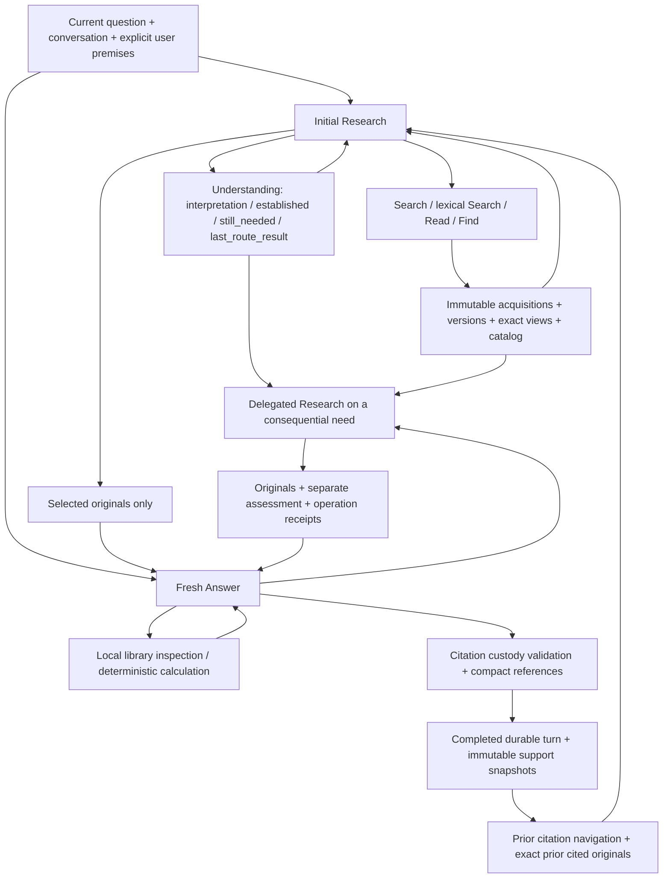
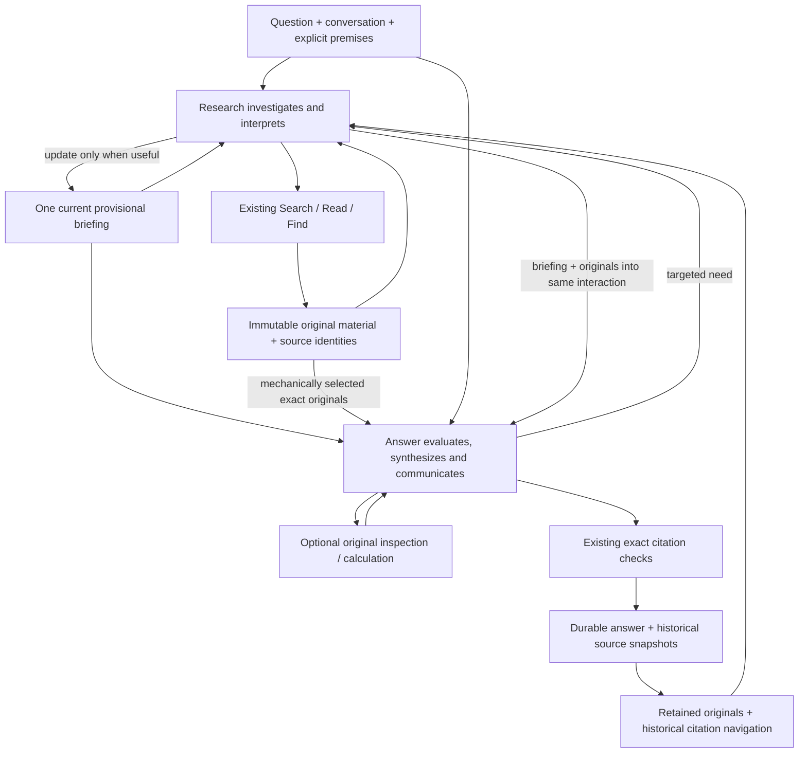

# Research–Answer briefing simplification 01

Status: authorized local experimental implementation; offline verification only.
No publication, promotion, live provider use or performance campaign is authorized.

## Architecture determination

Research investigates and interprets. Answer makes the final judgment and writes
the response. Research's provisional interpretation should cross this boundary
alongside its actual supporting originals. Fallibility requires the ability to
revise an interpretation, not compulsory reconstruction of its discovery.

One compact briefing is both Research's revisable working account and its handoff.
It can describe the provisional conclusion, connected findings and source IDs,
qualifications, contradictions, consequential gaps, and useful attempted or future
routes in proportion to the question. These are useful contents, not mandatory
subfields. A nullable update leaves the current account unchanged. No summarizer,
critic, claim graph, confidence score or persistent semantic memory is added.

The briefing is generated analysis, never external Evidence. It cannot authorize
a citation, expose a source, establish a missing fact, or bind Answer. Answer may
adopt supported findings, inspect material where the argument needs scrutiny,
revise the assessment, or request targeted Research in its existing interaction.

The ordinary checkout was clean at rejected experiment `95e22ff`. GitHub `main`
was independently verified as `7afc75df4f28e9c3bb12dacfe729d7678c45a6ac`.
The new local branch `codex/research-answer-briefing-01` starts at operational
repair checkpoint `c21d427`, preserving its provider-availability and launcher
repairs. The one-pass commits `48757c5` and `95e22ff` are excluded. Existing
branches, worktrees, and local evaluation artifacts remain intact.

## Before: logical dependency graph



The initial `Understanding` has no edge to Answer. Answer is instructed to
reconstruct interpretation from originals. Delegated Research separately rewrites
an `Understanding` and an `assessment`; its useful analysis is presented as
navigation and Answer is told to read independently again.

## Before: field and packet accounting

| Element | Producer → consumer | Decision enabled; disposition |
| --- | --- | --- |
| Question, date, conversation | Session/runtime → both roles | Intent, scope, corrections, explicit premises. Keep. Assistant history is discourse, not Evidence. |
| Historical citation provenance | Saved turns → Research | Locate exact prior support; keep as navigation. |
| Exact immediately prior cited text | Session → initial Research | Legitimate reuse without reacquisition; keep. |
| `interpretation` | Research → later Research | Task interpretation; merge into proportional briefing when useful. |
| `established[].statement/evidence_refs` | Research → later Research; initial snapshot → delegated worker | Relationships and qualifications are valuable but withheld initially. Replace the rigid finding ledger with briefing prose and source references. |
| `still_needed` | Research → later Research | Directs further investigation; communicate consequential gaps in the same briefing. |
| `last_route_result` | Research → later Research | Often repeats acquisition receipts. Remove mandatory restatement. |
| `action`, `requests` | Research → executor | Necessary next action; keep a common research/return contract. |
| Request filler fields | Research → schema, ignored by operation | Search needs no read offsets or retain scope. Use operation-specific shapes where strict native schemas permit. |
| `retain` | Research → next attention packet | Controls repeated original transmission; keep explicit selection, no semantic retention lifecycle. Shelved originals remain locally available. |
| Initial `answer_evidence_refs` | Research → AnswerLibrary | Selects initial exact originals. Unify with delegated `evidence_refs`. |
| Delegated `evidence_refs`, optional exact-text locator | Research → mechanical range resolver → AnswerLibrary | Selects originals without making rewritten text Evidence. Keep optional locator recovery and exact range selection; share with initial handoff. |
| `assessment` | Delegated Research → Answer | Useful interpretation duplicated beside Understanding. Remove in favor of the same briefing. |
| Frozen initial + current Understanding | Runtime → delegated worker | Duplicate semantic accounts. Keep one latest revisable briefing, plus immutable question and current need. |
| Catalog | Acquisition → both roles | Source navigation without bodies or authority. Keep; Answer can inspect omitted material. |
| `last_route`, `failed_external_reads`, prior acquisition history | Runtime → worker; overlapping subsets → Answer | Prevent repeating attempts. Consolidate worker receipts; give Answer actionable limitations rather than duplicate operation histories. |
| Evidence bodies and identifying metadata | Acquisition/selection → Research and Answer | Actual support; retain exact bytes, source/version/range identity. Runtime assembles material. |
| Pending delivery, resources, safe errors | Runtime → roles | Honest operational limits; preserve without treating exhaustion as support. |
| Answer posture/support basis/prose/missing information | Answer → finalizer | Distinct useful consumers; retain the four-field final contract. |
| Citation aliases | Answer → resolver | Validate membership and custody, group source numbers. Keep; analysis references alone never add membership. |
| Completed answers/acquisitions/citations | Finalizer → durable store/Reader/follow-up | Historical inspection and legitimate source reuse. Keep existing durable schema; do not persist briefings as factual memory. |

Repeated source text remains necessary when Research deliberately retains it in
its stateless decision packet. The redesign allows shelved originals to stay
available by ID while their useful interpretation survives in the briefing.
Answer's existing native history already retains initial context and tool results;
there is no new continuation or source-transmission framework.

## After: logical dependency graph



The diagram reuses the same Research responsibility for initial and delegated
episodes; Answer never becomes an external investigator. There are still only
two semantic roles and one ordinary execution path.

## Complete implementation brief

Implement one local revision in the ordinary Research-first/resumable Answer
path. Replace the structured Understanding ledger and distinct delegated schema
with a shared decision carrying `briefing`, `action`, executable `requests`,
`retain`, and `evidence_refs`. A null briefing preserves its previous value;
updates replace the compact account when new understanding warrants it. Initial
and delegated handoffs deliver `research_briefing` alongside exact originals.
Do not add a model call to construct either handoff.

Rewrite Research instructions around investigation, proportional useful findings,
worthwhile continuation and honest stopping. Rewrite Answer instructions around
evaluating and using this work, with source scrutiny where needed. Preserve
external grounding, explicit premise distinctions, developed conversational
answers, conditional reasoning, arithmetic, qualifications, and partial/unable
responses. Keep the small final Answer decision and native tool continuation.

Use the same exact selection machinery for both handoffs. Admit independently
valid selections and report invalid/omitted entries without discarding all useful
support. Briefing prose is never parsed into source membership. Invalid retain
references cannot expose material. Bound structural Research correction to one
retry per episode, then return an honest operational limitation and valid prior
work; do not spend the turn on repeated shape/identity repairs. Preserve local
source recovery, optional exact locator recovery, PDF identity, same-version
reuse, and local inspection after external denial.

Leave providers, routing, model defaults, packaging, UI, durable schema and
credential handling unchanged. Consolidate duplicate worker receipts and prompts
without inventing a semantic controller. Update surviving tests, delete obsolete
implementation assertions, and document changed current truth.

Verify through real `ResearchSession.ask()` and the production model/tool/citation
path with injected model responses and acquisition fixtures. Cover actual briefing
receipt/use, selected originals, initial and delegated response, revision under
conflicting material, partial answers, premises/calculation, durable reopen and
follow-up, malformed references, bounded correction, and important source recovery.
Run focused tests, the complete offline suite, Ruff, compilation, and configured
pre-commit checks; repair in scope. No live model/search/read, comparison campaign,
push, PR, merge, rebase, destructive reset, branch deletion or main alteration.

Offline evidence establishes plumbing and deterministic safeguards. It does not
establish that a real model reasons better, stops earlier, costs less, is faster,
or that a weaker/local model is reliable. Report those limits and leave promotion
and any future evaluation to separate human authorization.

## Technical review

**Outcome: met for the authorized local technical experiment.** The briefing
handoff functions end to end through the existing production components with
injected models and acquired-source fixtures. This is not a production promotion
or evidence of real-model quality, stopping or economic improvement.

The settled design and implementation brief above preceded runtime edits. The
implemented path uses one `research_episode` and one `ResearchDecision` for both
initial and delegated work. `Understanding`, `ScopedFinding`,
`DelegatedResearchDecision`, `answer_evidence_refs`, separate `assessment`, frozen
initial worker understanding, and duplicated model-facing receipt packets are
removed. No compatibility adapter, flag or alternate engine retains them.

Answer receives the actual provisional findings and original material. Its prompt
permits adoption, scrutiny and revision; it no longer mandates an independent
reconstruction of every finding. The existing small Answer decision, native
continuation, calculator, local library, resolver and durable store remain.
Search requests now emit only kind/query; Read and Find have their own relevant
fields. A null briefing update avoids regeneration when nothing changed. The
runtime still retransmits source text deliberately retained for a stateless
Research call; it does not claim to eliminate all repeated reading or context.

Source integrity remains a mechanical guarantee: selections resolve to exact
acquired text, actual Answer delivery controls membership, invalid briefing IDs
cannot become citations, and the resolver verifies source/version/view custody.
These checks do not prove semantic entailment. Existing source-level citation
grouping may save multiple supplied versions under one source, without claiming
passage-level localization. Historical snapshots remain unchanged after refresh
and reopen.

### Offline evidence

| Required behavior | Exercised production path / evidence |
| --- | --- |
| Investigation and useful initial briefing | `test_research_briefing.py`: source-discovered engine relationship drives a Read; actual initial Answer callback consumes briefing and exact originals. |
| Targeted delegation and same Answer continuation | API and plan-shaped transports: Answer requests an update, Research revises a provisional finding, and the same native history continues. |
| Conflicting/superseding originals | Old 7-unit and new 9-unit rule both retained; revised briefing selects current interpretation. Second delegated episode receives the latest briefing, not the initial one. |
| No unnecessary rewrite/retransmission | Null briefing preserves the current account; previously supplied exact E2 is reused without another body in its delegated return. |
| Calculation and explicit premises | Existing calculator integration plus a source-free 12 × 7 × 2 conditional result. Mixed factual calculations keep external support. |
| Honest partial and malformed selections | Valid E1 survives C1/E99 errors without another Research call; partial identifies missing profit. Briefing-only E99 cannot authorize a citation or commit a turn. |
| Durable session/follow-up | Native result saves and reopens; follow-up reads retained old/new material without acquisition, starts fresh briefing, and preserves historical citation snapshots/Reader content. |
| Bounded malformed output | Eight API/plan initial/delegated cases cover bad JSON/schema and invalid action shape: one correction, then last valid briefing/originals and a safe operational limitation. |
| Source recovery | Existing exact locator, contained-view reuse, post-external-denial local selection, PDF, historical view and library recovery tests pass. |
| Publication and safety boundaries | Existing strict citation, missing-citation correction, rollback, privacy, isolation, CLI, Reading Room and provider-configuration tests pass. |

The final full offline run passed **1024 tests, with 4 environment skips**, in
26.44 seconds. Skips are Windows hard-link/junction checks in forensic launcher,
forensic Reading Room and Reading Room tests; that environment-specific coverage
is not claimed. The six new briefing integrations and focused recovery/contract
checks also passed. Ruff, Python compilation over core/scryraven/scripts/tests,
Git diff whitespace checks and configured pre-commit hooks passed. Final staged
pre-commit confirmation is recorded with the delivery receipt.

Verification used the repository `.venv` interpreter and unique temporary roots.
An external temporary `sitecustomize` guard denied external sockets/DNS during
pytest while allowing loopback fixture servers. No live product model, Exa,
Serper or LinkUp call ran. Pre-commit downloaded its configured development hooks;
that tooling setup did not execute product providers. Windows sandbox restrictions
required escalation for Git branch/commit writes and pre-commit MSYS setup.
No private environment values, credentials or unrelated session data were read.

Logs and the temporary network guard are retained at
`C:\tmp\scryraven-briefing-01`. The reviewed October 25 one-pass report and
operational-repair handoff were historical context only. Existing evaluation
corpora and experiment artifacts were not deleted or rewritten. New synthetic
mechanical witnesses are preserved as tracked regression fixtures; no new
comparative model-evaluation corpus or performance campaign was created.

### Scope, removal and remaining limits

Removal is complete for the replaced contracts, callers and obsolete tests.
No new semantic role, persistent lifecycle, source authority, provider routing,
model assignment, packaging or UI change was introduced. The intentional tradeoff
is that briefing prose is flexible and fallible: its embedded references do not
undergo a second structured-finding validation, and Answer must judge their
support. Invalid actual source selections remain excluded and explicitly reported.
The finite Research correction allowance trades repeated shape repair for honest
handoff of useful prior work; it does not certify research completeness.

`PRODUCT.md` records the user-authorized responsibility boundary. `CURRENT.md`,
README and current architecture documentation now describe this experimental
implementation and its limits. Historical experiment reports retain their dates
and claims. An independent review of the final runtime diff found no additional
actionable defect.

Unproved: actual live provider acceptance of the revised union schema; real-model
briefing quality, source entailment, completeness, stopping and revision judgment;
latency, cost or call-count improvements; weaker/local-model reliability; general
long-session behavior. Offline adapters and strict-schema structural checks do
not substitute for those observations. No successor phase, PR or promotion is
automatically authorized.

### Local handoff

Branch: `codex/research-answer-briefing-01`. Implementation is a local checkpoint
above `c21d4274f8995ea601a91fb9bc5dbd0e7dbd368e`; the exact tested runtime commit
and final head are recorded in the final delivery receipt. No material runtime
change followed the successful final regression. Subsequent report edits only
record verification and commit identity. `main` remains
`7afc75df4f28e9c3bb12dacfe729d7678c45a6ac`; rejected one-pass branch remains
`95e22ff390316df8e191d0587a8fa0ef5cde43fd`. Nothing was pushed or published.
Human review may accept, revise or reject this local design; no further action
or promotion is implied.


### Exact changed files relative to c21d427

```text
CURRENT.md
PRODUCT.md
README.md
docs/architecture/RESEARCH.md
docs/operator/RESEARCH_ANSWER_BRIEFING_01.md
scryraven/dogfood_diagnostics.py
scryraven/model.py
scryraven/research.py
tests/reading_room_samples.py
tests/test_alternate_discovery.py
tests/test_answer_calculator_runtime_01.py
tests/test_answer_correction_efficiency_01.py
tests/test_answer_evidence_layout.py
tests/test_answer_finalization.py
tests/test_answer_library.py
tests/test_answer_missing_citation_correction_01.py
tests/test_answer_presentation.py
tests/test_answer_runtime_hygiene_01.py
tests/test_cli.py
tests/test_concurrent_exa_search.py
tests/test_durable_support_reader.py
tests/test_exa_deep_bootstrap.py
tests/test_failed_external_reads.py
tests/test_forensic_reading_room_01.py
tests/test_latency_instrumentation_01.py
tests/test_library_navigation_provenance.py
tests/test_library_read_navigation.py
tests/test_model_role_config.py
tests/test_packet_promotion_boundaries.py
tests/test_pdf_documents.py
tests/test_persistent_sessions.py
tests/test_prior_cited_preexposure.py
tests/test_production_plan_transport.py
tests/test_prompt_cache_economy.py
tests/test_provider_availability.py
tests/test_reading_room.py
tests/test_research_briefing.py
tests/test_research_first_resumable.py
tests/test_research_integration.py
tests/test_research_loop.py
tests/test_research_session.py
tests/test_search_novelty.py
tests/test_user_premise_answer_basis_01.py
```
